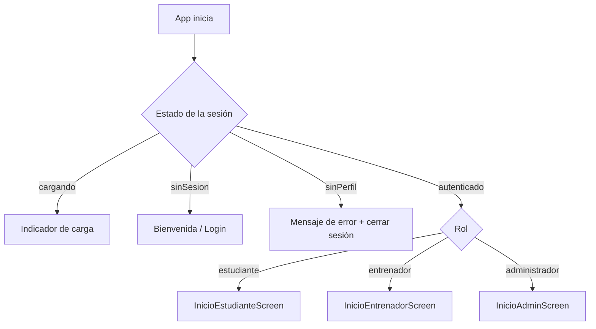

# Patrones de diseño — Samán Deportivo

**Responsable:** Gabriel

Este documento explica los patrones de diseño que usa la aplicación, en qué archivo está cada uno y qué problema resuelve. Los ejemplos son fragmentos reales del código del repositorio.

## Resumen

| Patrón | Tipo | Dónde está | Qué resuelve |
| --- | --- | --- | --- |
| Factory Method | Creacional | `lib/models/persona.dart` | Crear el tipo correcto de usuario a partir de Firestore |
| Observer | Comportamiento | `lib/features/auth/controllers/sesion_controller.dart` | Avisar a la interfaz cuando cambia la sesión |
| Provider (inyección de dependencias) | Arquitectura | `lib/main.dart` | Compartir la sesión con todas las pantallas |
| Repository | Arquitectura | `lib/features/perfil/data/` | Separar la interfaz del acceso a Firestore |
| AuthGate (guardia de navegación) | Arquitectura | `lib/core/router/auth_gate.dart` | Mostrar la pantalla que corresponde a cada estado y rol |
| Composición de widgets | Estructural | `lib/core/widgets/layout_responsivo.dart` | Reutilizar la misma navegación en los tres roles |
| Doble de prueba (Fake) | Pruebas | `test/core/router/auth_gate_test.dart` | Probar sin conectarse a Firebase |

## 1. Factory Method

**Problema.** Todos los usuarios se guardan en la misma colección `usuarios` de Firestore. Al leer un documento, la app tiene que crear un `Estudiante`, un `Entrenador` o un `Administrador` según el campo `rol`.

**Solución.** La clase abstracta `Persona` tiene un constructor de fábrica que lee el rol y delega en la subclase correcta. Quien llama solo pide "una persona" y no necesita saber qué subclase recibe.

```dart
factory Persona.fromMap(String uid, Map<String, dynamic> datos) {
  final rol = Rol.desdeTexto(datos['rol'] as String?);
  return switch (rol) {
    Rol.estudiante => Estudiante.fromMap(uid, datos),
    Rol.entrenador => Entrenador.fromMap(uid, datos),
    Rol.administrador => Administrador.fromMap(uid, datos),
  };
}
```

**Ventaja.** Si se agrega un rol nuevo al enum `Rol`, el `switch` exhaustivo obliga a manejarlo aquí, y el compilador avisa si se olvida.

## 2. Observer

**Problema.** La sesión cambia en momentos que la interfaz no controla: el usuario inicia sesión, la cierra, o su documento en Firestore se modifica. Las pantallas tienen que enterarse sin estar preguntando todo el tiempo.

**Solución.** `SesionController` extiende `ChangeNotifier`. Es el *sujeto* observado: escucha a Firebase Auth y a Firestore y, cada vez que algo cambia, llama a `notifyListeners()`. Las pantallas son los *observadores*.

```dart
void _cambiarEstado(EstadoSesion nuevo) {
  _estado = nuevo;
  notifyListeners(); // avisa a todos los widgets suscritos
}
```

Los widgets se suscriben con `context.watch<SesionController>()` y Flutter los vuelve a dibujar cuando reciben el aviso.

## 3. Provider (inyección de dependencias)

**Problema.** Varias pantallas necesitan la misma sesión. Si cada una creara su propio `SesionController`, habría varias conexiones a Firebase y datos que no coinciden.

**Solución.** Se crea una sola instancia en `main.dart` y se registra con `MultiProvider`. Cualquier widget de la app la obtiene desde el contexto, sin crearla.

```dart
MultiProvider(
  providers: [
    ChangeNotifierProvider(lazy: false, create: (_) => SesionController()),
  ],
  child: const SamanDeportivoApp(),
)
```

La misma idea se aplica dentro de las clases. `SesionController` recibe `AuthService` y `FirebaseFirestore` como parámetros opcionales, y las pantallas de inicio reciben `nombre` y `onCerrarSesion` desde afuera en vez de buscarlos solas. Así cada pieza se puede probar por separado.

## 4. Repository

**Problema.** Si la pantalla de perfil hablara directamente con Firestore, no se podría probar sin una base de datos real y quedaría atada a esa tecnología.

**Solución.** `PerfilRepository` es un contrato abstracto con las operaciones que necesita el perfil. `FirestorePerfilRepository` es la implementación real con Firestore. La pantalla solo conoce el contrato.

```dart
abstract class PerfilRepository {
  Stream<PerfilUsuario?> observarPerfil(String uid);
  Future<void> actualizarPerfil({required String uid, required String nombre, String? carnet});
}
```

En las pruebas se le pasa a `PerfilScreen` un repositorio falso en lugar del de Firestore.

## 5. AuthGate (guardia de navegación)

**Problema.** Al abrir la app hay que decidir qué mostrar: todavía no se sabe si hay sesión, puede no haberla, el usuario puede no tener perfil, o puede ser estudiante, entrenador o administrador. Si cada pantalla revisara esto por su cuenta, la lógica quedaría repetida.

**Solución.** Un único widget, `AuthGate`, es la pantalla inicial (`home`) de la app. Observa al `SesionController` y decide en un solo lugar:



```dart
return switch (persona.rol) {
  Rol.estudiante => InicioEstudianteScreen(...),
  Rol.entrenador => InicioEntrenadorScreen(...),
  Rol.administrador => InicioAdminScreen(...),
};
```

**Ventaja.** Cuando el usuario cierra sesión, el controlador avisa (patrón Observer), el `AuthGate` se redibuja y la app vuelve sola a la bienvenida, sin que ninguna pantalla tenga que navegar manualmente.

## 6. Composición de widgets

**Problema.** Los tres roles tienen la misma estructura de navegación (barra inferior en el móvil, menú lateral en el escritorio) pero con secciones distintas. Copiar esa estructura tres veces duplicaría mucho código.

**Solución.** `LayoutResponsivo` arma la navegación una sola vez y recibe la lista de secciones como datos (`DestinoNavegacion`: etiqueta, ícono y pantalla). Cada pantalla de inicio solo describe sus secciones:

```dart
LayoutResponsivo(
  titulo: 'Samán',
  subtitulo: Rol.entrenador.etiqueta,
  destinos: [
    DestinoNavegacion(etiqueta: 'Dashboard', icono: ..., pantalla: ...),
    DestinoNavegacion(etiqueta: 'Mis disciplinas', icono: ..., pantalla: ...),
    // ...
  ],
)
```

Según el ancho de la pantalla (`LayoutBuilder`), el layout elige cómo mostrar la navegación:

| Ancho | Navegación |
| --- | --- |
| Menos de 600 px (móvil) | `NavigationBar` abajo; si hay más de 5 secciones, menú desplegable (`NavigationDrawer`) |
| 600 a 1024 px (tablet) | `NavigationRail` compacto, solo íconos |
| Más de 1024 px (escritorio) | `NavigationRail` extendido, con el nombre de la app, el rol y las etiquetas |

## 7. Doble de prueba (Fake)

**Problema.** El `SesionController` real se conecta a Firebase al crearse, así que no sirve para pruebas automáticas.

**Solución.** En las pruebas del AuthGate se usa `SesionFalsa`, una clase que implementa la misma interfaz que `SesionController` pero cuyo estado se elige a mano. Como el `AuthGate` solo depende de esa interfaz (gracias a Provider), no nota la diferencia.

```dart
class SesionFalsa extends ChangeNotifier implements SesionController { ... }

await _mostrar(tester, SesionFalsa(EstadoSesion.autenticado,
    personaActual: _persona(Rol.entrenador)));
expect(find.byType(InicioEntrenadorScreen), findsOneWidget);
```

Así se prueban los cuatro estados de la sesión y los tres roles en pocos segundos y sin conexión.

## Cómo se relacionan

1. **Factory Method** crea la `Persona` correcta desde Firestore.
2. El **Observer** (`SesionController`) guarda esa persona y avisa cuando cambia.
3. **Provider** hace llegar ese controlador a toda la app.
4. El **AuthGate** lo observa y elige la pantalla según el estado y el rol.
5. Cada pantalla de inicio se arma por **composición** con `LayoutResponsivo`.
6. El perfil lee sus datos a través de un **Repository**.
7. Los **dobles de prueba** permiten verificar todo lo anterior sin Firebase.
